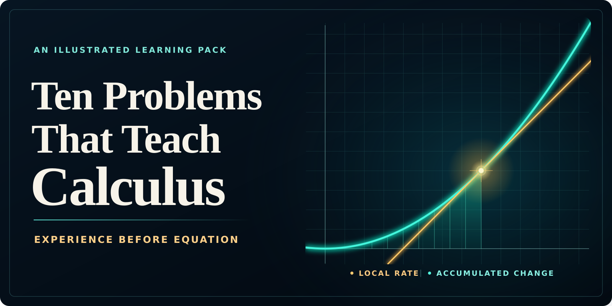

# Ten Problems That Teach Calculus

## Executive summary

**This project teaches learners to recognize when they need calculus, then use it to answer a question they can explain and check.** It began as a thought experiment: if you could teach only ten problems, which ones would give learners the most reusable ways to think? We chose each problem for a decision it forces, not just a technique it exercises.

The course moves from **limits** to two complementary ways of reasoning about change. A derivative tells you what is happening at one instant. An integral tells you what small contributions add up to over an interval. The Fundamental Theorem connects the two. The later problems use those ideas to make a prediction, assess its accuracy, or decide when a computation can stop. This is a compact introduction to single-variable calculus, not a replacement for a full course.

The teaching principle is **Experience Before Equation**. Predict what will happen, decide what you need to know, work it out, then check whether the answer serves the purpose. The cart that reverses direction makes that principle concrete: where it ends up and how far its wheels rolled are different questions, even though they use the same velocity record.

[Download the current project as a ZIP](https://github.com/RandoSY/ten-problems-that-teach-calculus/archive/refs/heads/main.zip)

## What we built and why

| Material | Why it exists |
| --- | --- |
| [The Shape of Calculus](docs/the-shape-of-calculus.pdf) | An illustrated course map and a chapter on why each problem was chosen. Use it to recognize the idea in a new setting. |
| [Worked solutions](docs/ten-problems-that-teach-calculus.pdf) | Ten step-by-step derivations. Use them to see why the answer follows, which assumptions matter, and what the result means. |
| [Python companion](python/README.md) | Ten numbered scripts with ready-to-view graphs. Use them to trace the move from an equation to an algorithm and distinguish a numerical check from a proof. |
| [Classroom pilots](classroom-pilots/README.md) | Printable student handouts and a separate teacher guide for Problems 06 and 09. Use them to see whether learners can choose the method before it is named and transfer it afterward. |

**Start with Problem 06.** Ask for both reports on the cart's trip before opening the worked solution. Then run the [Python example](python/06_distance_vs_displacement.py) and see how adding signed changes versus adding their magnitudes answers the two questions. For the cooling pilot, keep the later readings teacher-side until students commit to a prediction. The guide offers supervised live measurement or explicitly synthetic practice data.

## Verification and what remains

All ten Python programs ran and regenerated their plots. The four PDFs were checked for rendering and navigation, and the central mathematical results and pilot keys were checked independently. The cover's gold line is the exact tangent to the teal parabola at (2, 4). The [project review](docs/PROJECT-REVIEW.md) records what was checked, corrections made, and the next classroom step.

The materials are **ready to pilot, not yet classroom-tested**. The next step is to run Problems 06 and 09 with learners and see what they can explain and transfer without a prompt.

## Editable sources

The two readers have editable [XeLaTeX sources](source/). The handouts and teacher guide have their own [source files](classroom-pilots/source/). Compile from the relevant folder, twice for PDF bookmarks. The published PDFs are listed in [PDF-SHA256.txt](PDF-SHA256.txt).

The classroom pilots were first published in [CORE 10](https://github.com/RandoSY/core-10/tree/0873f46462c40f1137485cd8a5a885b80437cb1e/calculus-pilots) and are maintained here.
