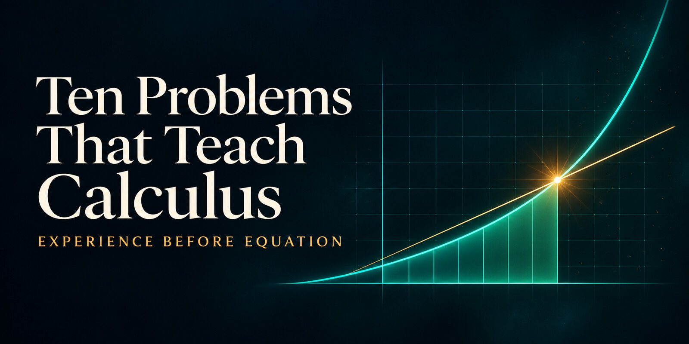

# Ten Problems That Teach Calculus

A compact single-variable calculus curriculum built around **Experience Before Equation**. Learn to recognize the mathematical question, work it out on paper, and see what it becomes in software.

| Start here | What's inside |
| --- | --- |
| [The Shape of Calculus](docs/the-shape-of-calculus.pdf) | Illustrated course map and why each problem matters |
| [Ten Problems That Teach Calculus](docs/ten-problems-that-teach-calculus.pdf) | Ten expanded worked solutions |
| [Python companion](python/README.md) | Ten runnable NumPy/Matplotlib programs, ready-to-view plots, and sample output |
| [Classroom pilots](classroom-pilots/README.md) | Student handouts and a separate teacher guide for distance versus displacement and the Kitchen Inquiry Lab cooling challenge |

## Teaching with the pilots

Print the A sheets separately and give them out before the B sheets. Have learners say what they need to find in their own words before naming the method. Keep the later cooling readings teacher-side until teams have committed to a prediction. The guide supports either a supervised live experiment or a staged synthetic practice record. These lessons are ready to pilot and have not yet been classroom-tested.

## Source and verification

Editable XeLaTeX files are included in [source/](source/) for both readers and in [classroom-pilots/source/](classroom-pilots/source/) for the handouts and guide. Compile the main file for each reader, or the student and teacher build files for the pilots, from its own folder. Compile twice to resolve PDF bookmarks. The originals are listed in [PDF-SHA256.txt](PDF-SHA256.txt).

The classroom pilots were first published on the CORE 10 [original pilot commit](https://github.com/RandoSY/core-10/tree/0873f46462c40f1137485cd8a5a885b80437cb1e/calculus-pilots).
